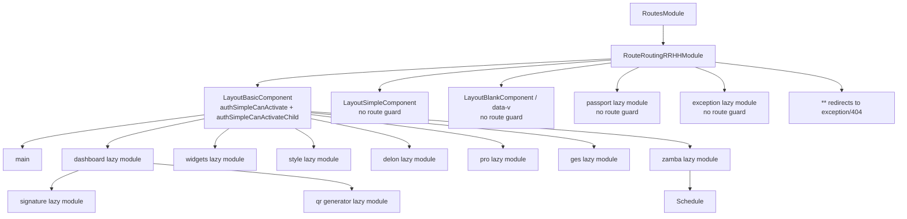

# Zamba Angular Route Flow

This guide describes the routes activated by `RoutesModule` and `RouteRoutingRRHHModule`. The router uses hash URLs (`environment.useHash` is `true`), so the links below use `http://localhost/#/...`. If the development server is listening on port 4200, use `http://localhost:4200/#/...` instead.

## Entry Point

`RoutesModule` selects `RouteRoutingRRHHModule`. The separate `RouteRoutingModule` is imported but not selected, so its routes are not active in this app configuration. In particular, its `tools/elements` and `tools/form` entries are not included here.

The diagram shows feature boundaries, not every leaf. The tables below list the route paths and the component that renders each screen.

## Guard Behavior

| Guard | Where it applies | Meaning in this route configuration |
| --- | --- | --- |
| `authSimpleCanActivate` | The parent route rendered by `LayoutBasicComponent` | Checks access before entering the authenticated layout. |
| `authSimpleCanActivateChild` | Children of the `LayoutBasicComponent` route | Checks navigation to `/main`, `/dashboard/...`, `/widgets/...`, `/style/...`, `/delon/...`, `/pro/...`, `/ges/...`, and `/zamba/...`. This applies to descendants of those route branches as well. |
| `aclCanActivate` with `data.guard: 'user1'` | `/delon/guard/auth` | Applies the ACL permission check for `user1`. |
| `aclCanActivate` with `data.guard: 'admin'` | `/delon/guard/admin` | Applies the ACL permission check for `admin`. |
| `canLeave` (`CanDeactivate`) | `/delon/guard/leave` | Prompts before leaving; cancelling the prompt keeps the current route. |

`/tools/...`, `/data-v/...`, `/passport/...`, `/welcome`, and `/exception/...` are outside the `LayoutBasicComponent` route and do not inherit its two auth guards. The `delon` ACL checks are additional route-level checks, not replacements for inherited auth checks.

## Authenticated Layout

These routes render inside `LayoutBasicComponent`, so both `authSimpleCanActivate` and `authSimpleCanActivateChild` apply.

### Main and Dashboard

| Path | Screen / component | Notes |
| --- | --- | --- |
| [`/`](http://localhost/#/) | Redirect | Redirects to `/main`. |
| [`/main`](http://localhost/#/main) | `MainPageComponent` | Main application page. |
| [`/dashboard`](http://localhost/#/dashboard) | Redirect | Dashboard module redirects its empty path to `/dashboard/widgets`. |
| [`/dashboard/default`](http://localhost/#/dashboard/default) | `DefaultComponent` | Default dashboard/account settings view. |
| [`/dashboard/v2`](http://localhost/#/dashboard/v2) | `DashboardV1Component` | Alternate dashboard view. |
| [`/dashboard/analysis`](http://localhost/#/dashboard/analysis) | `DashboardAnalysisComponent` | Analytics dashboard. |
| [`/dashboard/copilot-telemetry`](http://localhost/#/dashboard/copilot-telemetry) | `CopilotTelemetryComponent` | Copilot telemetry view. |
| [`/dashboard/workflow-tasks`](http://localhost/#/dashboard/workflow-tasks) | `WorkflowTasksComponent` | Workflow task monitoring. |
| [`/dashboard/monitor`](http://localhost/#/dashboard/monitor) | `DashboardMonitorComponent` | Monitoring dashboard. |
| [`/dashboard/workplace`](http://localhost/#/dashboard/workplace) | `DashboardWorkplaceComponent` | Workplace dashboard. |
| [`/dashboard/widgets`](http://localhost/#/dashboard/widgets) | `WidgetsContainerComponent` | Dashboard widget container/editor. |
| [`/dashboard/signature`](http://localhost/#/dashboard/signature) | `SignatureContainerComponent` | Signature workflow container, loaded from `SignatureModule`. |
| [`/dashboard/qr`](http://localhost/#/dashboard/qr) | `QRGeneratorComponent` | Loads the current user's pay-stub PDF for QR generation. |
| [`/dashboard/qr/123`](http://localhost/#/dashboard/qr/123) | `QRGeneratorComponent` | Loads a PDF by the supplied identifier; replace `123` with the file ID. |
| [`/dashboard/gestion`](http://localhost/#/dashboard/gestion) | `QuickActionsComponent` | Quick actions/management screen. |

Dashboard routing is defined in [dashboard-routing.module.ts](../src/app/routes/dashboard/dashboard-routing.module.ts). The `/dashboard/reports` routes are declared by the root RRHH router rather than the dashboard module:

| Path | Screen / component | Notes |
| --- | --- | --- |
| [`/dashboard/reports`](http://localhost/#/dashboard/reports) | `ReportComponentComponent` | Report area/container. |
| [`/dashboard/reports/create`](http://localhost/#/dashboard/reports/create) | `ReportEditorComponent` | Create a report. |
| [`/dashboard/reports/edit/123`](http://localhost/#/dashboard/reports/edit/123) | `ReportEditorComponent` | Edit report `123`. |
| [`/dashboard/reports/view/123`](http://localhost/#/dashboard/reports/view/123) | `ReportViewerComponent` | View report `123`. |
| [`/dashboard/reports/chartcontainer/123`](http://localhost/#/dashboard/reports/chartcontainer/123) | `ChartContainerComponent` | Display the report chart for ID `123`. |

### Widgets

The lazy `WidgetsModule` has no empty-path child, so use one of the paths below rather than `/widgets` by itself. These routes are still inside the authenticated layout.

| Path | Screen / component | What it does |
| --- | --- | --- |
| [`/widgets/calendar`](http://localhost/#/widgets/calendar) | `CalendarComponent` | Calendar view. |
| [`/widgets/carousel`](http://localhost/#/widgets/carousel) | `CarouselComponent` | Carousel demo/view. |
| [`/widgets/pending-tasks`](http://localhost/#/widgets/pending-tasks) | `PendingTasksComponent` | Pending task list. |
| [`/widgets/pending-vacations`](http://localhost/#/widgets/pending-vacations) | `PendingVacationsComponent` | Pending vacation list. |

### Style and Delon Examples

| Path | Screen / component | What it does / guard |
| --- | --- | --- |
| [`/style/gridmasonry`](http://localhost/#/style/gridmasonry) | `GridMasonryComponent` | Masonry grid example. |
| [`/style/typography`](http://localhost/#/style/typography) | `TypographyComponent` | Typography examples. |
| [`/style/colors`](http://localhost/#/style/colors) | `ColorsComponent` | Color palette examples. |
| [`/delon/st`](http://localhost/#/delon/st) | `STDemoComponent` | Simple-table component example. |
| [`/delon/util`](http://localhost/#/delon/util) | `UtilComponent` | Delon utility examples. |
| [`/delon/print`](http://localhost/#/delon/print) | `PrintComponent` | Print example. |
| [`/delon/acl`](http://localhost/#/delon/acl) | `ACLComponent` | Access-control-list example; this route itself has no `aclCanActivate`. |
| [`/delon/guard`](http://localhost/#/delon/guard) | `GuardComponent` | Parent/view outlet for guard examples. |
| [`/delon/guard/leave`](http://localhost/#/delon/guard/leave) | `GuardLeaveComponent` | Leave-confirmation demo; `canLeave` runs when navigating away. |
| [`/delon/guard/auth`](http://localhost/#/delon/guard/auth) | `GuardAuthComponent` | ACL-gated view; requires the `user1` ACL key. |
| [`/delon/guard/admin`](http://localhost/#/delon/guard/admin) | `GuardAdminComponent` | ACL-gated view; requires the `admin` ACL key. |
| [`/delon/cache`](http://localhost/#/delon/cache) | `CacheComponent` | Cache example. |
| [`/delon/qr`](http://localhost/#/delon/qr) | `QRComponent` | QR-code example. |
| [`/delon/downfile`](http://localhost/#/delon/downfile) | `DownFileComponent` | File download example. |
| [`/delon/xlsx`](http://localhost/#/delon/xlsx) | `XlsxComponent` | Spreadsheet export/import example. |
| [`/delon/zip`](http://localhost/#/delon/zip) | `ZipComponent` | ZIP file example. |
| [`/delon/form`](http://localhost/#/delon/form) | `DelonFormComponent` | Delon form example. |

### Pro Screens

| Path | Screen / component | What it does |
| --- | --- | --- |
| [`/pro/form/basic-form`](http://localhost/#/pro/form/basic-form) | `BasicFormComponent` | Basic form example. |
| [`/pro/form/step-form`](http://localhost/#/pro/form/step-form) | `StepFormComponent` | Multi-step form example. |
| [`/pro/form/advanced-form`](http://localhost/#/pro/form/advanced-form) | `AdvancedFormComponent` | Advanced form example. |
| [`/pro/list/table-list`](http://localhost/#/pro/list/table-list) | `ProTableListComponent` | Table-based list. |
| [`/pro/list/basic-list`](http://localhost/#/pro/list/basic-list) | `ProBasicListComponent` | Basic list. |
| [`/pro/list/card-list`](http://localhost/#/pro/list/card-list) | `ProCardListComponent` | Card-based list. |
| [`/pro/list`](http://localhost/#/pro/list) | `ProListLayoutComponent` | List-page shell; child tabs/routes are listed below. |
| [`/pro/list/articles`](http://localhost/#/pro/list/articles) | `ProListArticlesComponent` | Article list. |
| [`/pro/list/projects`](http://localhost/#/pro/list/projects) | `ProListProjectsComponent` | Project list. |
| [`/pro/list/applications`](http://localhost/#/pro/list/applications) | `ProListApplicationsComponent` | Application list. |
| [`/pro/profile/basic`](http://localhost/#/pro/profile/basic) | `ProProfileBaseComponent` | Basic profile view. |
| [`/pro/profile/advanced`](http://localhost/#/pro/profile/advanced) | `ProProfileAdvancedComponent` | Advanced profile view. |
| [`/pro/result/success`](http://localhost/#/pro/result/success) | `ProResultSuccessComponent` | Successful operation result. |
| [`/pro/result/fail`](http://localhost/#/pro/result/fail) | `ProResultFailComponent` | Failed operation result. |
| [`/pro/account/center`](http://localhost/#/pro/account/center) | Redirect via `ProAccountCenterComponent` | Defaults to `/pro/account/center/articles`. |
| [`/pro/account/center/articles`](http://localhost/#/pro/account/center/articles) | `ProAccountCenterArticlesComponent` | Account center articles tab. |
| [`/pro/account/center/projects`](http://localhost/#/pro/account/center/projects) | `ProAccountCenterProjectsComponent` | Account center projects tab. |
| [`/pro/account/center/applications`](http://localhost/#/pro/account/center/applications) | `ProAccountCenterApplicationsComponent` | Account center applications tab. |
| [`/pro/account/settings`](http://localhost/#/pro/account/settings) | Redirect via `ProAccountSettingsComponent` | Defaults to `/pro/account/settings/base`. |
| [`/pro/account/settings/base`](http://localhost/#/pro/account/settings/base) | `ProAccountSettingsBaseComponent` | Basic account settings. |
| [`/pro/account/settings/security`](http://localhost/#/pro/account/settings/security) | `ProAccountSettingsSecurityComponent` | Security settings. |
| [`/pro/account/settings/binding`](http://localhost/#/pro/account/settings/binding) | `ProAccountSettingsBindingComponent` | Account binding settings. |
| [`/pro/account/settings/notification`](http://localhost/#/pro/account/settings/notification) | `ProAccountSettingsNotificationComponent` | Notification settings. |

### HR and Zamba Features

| Path | Screen / component | What it does |
| --- | --- | --- |
| [`/ges/empleado`](http://localhost/#/ges/empleado) | `EmpleadoComponent` | Employee management view. |
| [`/zamba/rule`](http://localhost/#/zamba/rule) | `RuleComponent` | Workflow rule form. |
| [`/zamba/form`](http://localhost/#/zamba/form) | `ViewFormComponent` | Dynamic form view. |
| [`/zamba/schedule`](http://localhost/#/zamba/schedule) | `ScheduleListComponent` | Searchable, filterable schedule list. |
| [`/zamba/schedule/dashboard`](http://localhost/#/zamba/schedule/dashboard) | `ScheduleDashboardComponent` | Schedule execution metrics and recent history; refreshes periodically. |
| [`/zamba/schedule/new`](http://localhost/#/zamba/schedule/new) | `ScheduleFormComponent` | Create a schedule. |
| [`/zamba/schedule/123`](http://localhost/#/zamba/schedule/123) | `ScheduleDetailComponent` | View schedule `123`. |
| [`/zamba/schedule/123/edit`](http://localhost/#/zamba/schedule/123/edit) | `ScheduleFormComponent` | Edit schedule `123`. |
| [`/zamba/schedule/123/logs`](http://localhost/#/zamba/schedule/123/logs) | `ExecutionLogsComponent` | View execution history for schedule `123`. |

The schedule list links to create, detail, edit, and log routes. Replace `123` in example links with an actual schedule ID. `ScheduleModule` is lazy-loaded only beneath `/zamba/schedule` in the current RRHH routing.

## Tools Layout

`/tools/...` renders in `LayoutSimpleComponent`. No auth, child-auth, ACL, or leave guard is configured on this route tree.

| Path | Screen / component | What it does |
| --- | --- | --- |
| [`/tools/taskhistory`](http://localhost/#/tools/taskhistory) | `TaskHistoryComponent` | Task history. |
| [`/tools/editor-docx`](http://localhost/#/tools/editor-docx) | `DocxEditorComponent` | DOCX editor. |
| [`/tools/editor-onlyoffice`](http://localhost/#/tools/editor-onlyoffice) | `OnlyofficeEditorComponent` | OnlyOffice editor. |
| [`/tools/word-editor`](http://localhost/#/tools/word-editor) | `TinymceElementComponent` | TinyMCE-based Word/document editor. |
| [`/tools/chart-viewer-premium`](http://localhost/#/tools/chart-viewer-premium) | `ChartContainerComponent` | Chart viewer. |
| [`/tools/editor-ckeditor5-premium`](http://localhost/#/tools/editor-ckeditor5-premium) | `Ckeditor5PremiumEditorComponent` | CKEditor 5 editor. |
| [`/tools/global-search`](http://localhost/#/tools/global-search) | `GlobalSearchElementComponent` | Global document search (`EntityId: HB Documentos`, `IndexId: GlobalSearch`). |
| [`/tools/web-bookmark`](http://localhost/#/tools/web-bookmark) | `WebBookmarkComponent` | Web bookmark view. |
| [`/tools/miniweb-bookmark`](http://localhost/#/tools/miniweb-bookmark) | `MiniwebBookmarkComponent` | Compact web bookmark view. |
| [`/tools/reports`](http://localhost/#/tools/reports) | `ReportComponentComponent` | Report area/container. |
| [`/tools/reports/create`](http://localhost/#/tools/reports/create) | `ReportEditorComponent` | Create a report. |
| [`/tools/reports/edit/123`](http://localhost/#/tools/reports/edit/123) | `ReportEditorComponent` | Edit report `123`. |
| [`/tools/reports/view/123`](http://localhost/#/tools/reports/view/123) | `ReportViewerComponent` | View report `123`. |
| [`/tools/reports/chartcontainer/123`](http://localhost/#/tools/reports/chartcontainer/123) | `ChartContainerComponent` | Display a report chart for ID `123`. |
| [`/tools/gestion`](http://localhost/#/tools/gestion) | `QuickActionsComponent` | Quick actions/management screen. |
| [`/tools/doshowtable`](http://localhost/#/tools/doshowtable) | `DoShowTableComponent` | Table display/demo. |
| [`/tools/signature`](http://localhost/#/tools/signature) | `SignatureContainerComponent` | Signature container. |
| [`/tools/permisos`](http://localhost/#/tools/permisos) | `PermissionsUserGroupComponent` | User/group permission management. |

## Blank, Passport, and Exception Layouts

These routes do not inherit the authenticated layout guards.

| Path | Screen / component | What it does |
| --- | --- | --- |
| [`/data-v/relation`](http://localhost/#/data-v/relation) | `RelationComponent` in `DataVRoutingModule` | Relation visualization under `LayoutBlankComponent`. |
| [`/passport/login`](http://localhost/#/passport/login) | `UserLoginVZambaComponent` | Zamba sign-in. |
| [`/passport/validate`](http://localhost/#/passport/validate) | `ValidateComponent` | Validate an account. |
| [`/passport/register`](http://localhost/#/passport/register) | `UserRegisterComponent` | Registration flow. |
| [`/passport/zregister`](http://localhost/#/passport/zregister) | `UserRegisterVZambaComponent` | Zamba registration flow. |
| [`/passport/register-result`](http://localhost/#/passport/register-result) | `UserRegisterResultComponent` | Registration result. |
| [`/passport/resend-result`](http://localhost/#/passport/resend-result) | `ResendResultComponent` | Verification resend result. |
| [`/passport/lock`](http://localhost/#/passport/lock) | `UserLockComponent` | Locked-user screen. |
| [`/passport/resendverificationemail`](http://localhost/#/passport/resendverificationemail) | `ResendVerificationEmailComponent` | Resend verification email. |
| [`/passport/resetpassword`](http://localhost/#/passport/resetpassword) | `ResetPasswordComponent` | Reset password. |
| [`/passport/changepassword`](http://localhost/#/passport/changepassword) | `ChangePasswordComponent` | Change password. |
| [`/passport/resetresult`](http://localhost/#/passport/resetresult) | `ResetResultComponent` | Password reset result. |
| [`/passport/changepasswordexpired`](http://localhost/#/passport/changepasswordexpired) | `ChangePasswordExpiredComponent` | Expired-password flow. |
| [`/passport/changepasswordresult`](http://localhost/#/passport/changepasswordresult) | `ChangePasswordResultComponent` | Password change result. |
| [`/passport/callback/login`](http://localhost/#/passport/callback/login) | `CallbackComponent` | Authentication callback; `login` is an example `type` value. |
| [`/welcome`](http://localhost/#/welcome) | `InitialPasswordWizardComponent` | Welcome / initial password wizard. |
| [`/exception/403`](http://localhost/#/exception/403) | `ExceptionComponent` (`type: 403`) | Forbidden error page. |
| [`/exception/404`](http://localhost/#/exception/404) | `ExceptionComponent` (`type: 404`) | Not-found error page. |
| [`/exception/500`](http://localhost/#/exception/500) | `ExceptionComponent` (`type: 500`) | Server error page. |
| [`/exception/trigger`](http://localhost/#/exception/trigger) | `ExceptionTriggerComponent` | Error trigger/demo. |

## Route Notes

- The top-level `**` route redirects unmatched URLs to `/exception/404`.
- The passport router declares a route with `path: '*'`; Angular's wildcard route is `**`, so that entry is a literal `*` path rather than a catch-all. It should not be relied on as the fallback.
- `PassportRoutingModule` also declares its own `main` route, but the earlier authenticated `/main` route matches first. The active `/main` screen is therefore `MainPageComponent`.
- Some feature roots have no empty child route. For example, `/style`, `/delon`, `/ges`, `/zamba`, `/tools`, and `/data-v` do not each define an index screen; navigate to one of their listed child paths.
- Route data such as titles, `preload`, `EntityId`, and `IndexId` is metadata for the app/router and does not add another URL segment.

## Source Files

- Active root routing: [routes.module.ts](../src/app/routes/routes.module.ts) and [routes-routing-rrhh.module.ts](../src/app/routes/routes-routing-rrhh.module.ts)
- Dashboard routing: [dashboard-routing.module.ts](../src/app/routes/dashboard/dashboard-routing.module.ts)
- Widgets routing: [widgets-routing.module.ts](../src/app/routes/widgets/widgets-routing.module.ts)
- Delon examples: [delon-routing.module.ts](../src/app/routes/delon/delon-routing.module.ts)
- Pro screens: [pro-routing.module.ts](../src/app/routes/pro/pro-routing.module.ts)
- HR and Zamba: [ges-routing.module.ts](../src/app/routes/ges/ges-routing.module.ts), [zamba-routing.module.ts](../src/app/routes/zamba/zamba-routing.module.ts), and [schedule-routing.module.ts](../src/app/routes/zamba/schedule/schedule-routing.module.ts)
- Standalone layouts: [data-v-routing.module.ts](../src/app/routes/data-v/data-v-routing.module.ts), [passport-routing.module.ts](../src/app/routes/passport/passport-routing.module.ts), and [exception-routing.module.ts](../src/app/routes/exception/exception-routing.module.ts)
